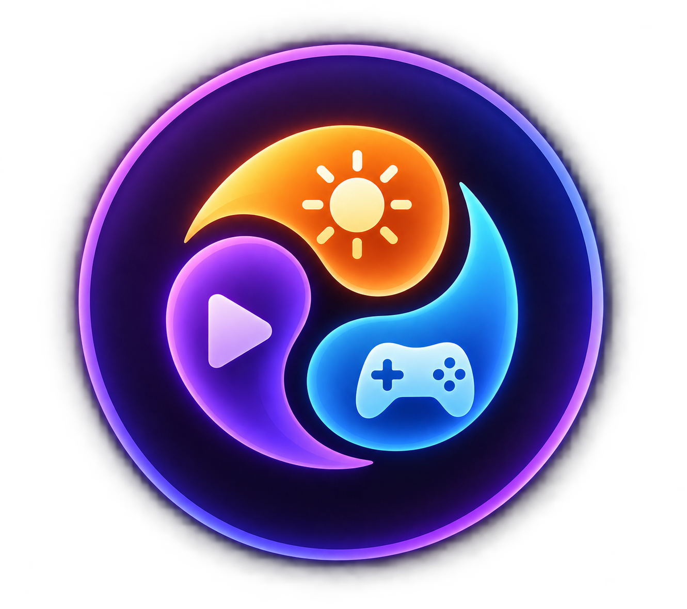

 <div align="center">



# Envia

### One shortcut. A whole new environment.

Switch between personalized Windows environments for gaming, studying, movies, and everyday work.

Control your desktop experience through customizable profiles — without manually changing every setting each time.

<br>

<a href="https://github.com/Hajime-GG/Envia/issues">Report an Issue</a>
&nbsp; · &nbsp;
<a href="https://github.com/Hajime-GG/Envia">GitHub Repository</a>

<br><br>

<a href="https://github.com/Hajime-GG/Envia/releases/latest">

</a>
<br><br>

<a href="https://apps.microsoft.com/detail/9N99R6LJHP63?hl=en-us&gl=IN&ocid=pdpshare" target="_self" >
	
</a>

<br><br>


</div>

---

## ✦ Your PC, Your Environment

Your PC serves different purposes throughout the day. Gaming calls for one configuration, studying calls for another, and watching a movie can benefit from a completely different setup.

**Envia brings these configurations together into one simple environment manager.**

Create a profile, personalize its settings, and switch to it when you need it. Instead of adjusting your desktop manually every time, let Envia handle the transition.

**One application. Multiple environments. A workflow that feels like yours.**

---

## ✨ Features

<table>
<tr>
<td width="50%" valign="top">

### 🎮 Environment Profiles

Create dedicated environments for Gaming, Studying, Movies, or your own custom activities. Keep the settings for each experience together.

</td>
<td width="50%" valign="top">

### ⚡ QuickSwitch

Use a configurable keyboard shortcut to switch environments quickly, without navigating through settings every time.

</td>
</tr>
<tr>
<td width="50%" valign="top">

### 🖥 Display Personalization

Configure supported display settings, including brightness, refresh rate, and wallpaper, according to your selected environment.

</td>
<td width="50%" valign="top">

### 🔊 Audio Control

Set the preferred volume for each environment and move between different listening setups as your activity changes.

</td>
</tr>
<tr>
<td width="50%" valign="top">

### 🌙 Night Light

Configure Night Light preferences and intensity for environments where a warmer display is preferred.

</td>
<td width="50%" valign="top">

### 🔋 Power Plans

Associate Windows power-plan preferences with your environments to help match your PC's power behavior to your current activity.

</td>
</tr>
<tr>
<td width="50%" valign="top">

### 🚀 Startup & System Tray

Configure startup behavior, minimize-to-tray preferences, and whether the Default environment should be applied at startup.

</td>
<td width="50%" valign="top">

### 🎨 Built for Everyday Use

Keep environment switching accessible through the application and system tray, with a streamlined workflow built around your preferences.

</td>
</tr>
</table>

---

## 🧭 How It Works

Envia organizes your preferred Windows settings into reusable environments.

```text
          YOUR ACTIVITY
                │
                ▼
       ┌──────────────────┐
       │      Envia       │
       │                  │
       │ Select an        │
       │ environment      │
       └────────┬─────────┘
                │
                ▼
       ┌──────────────────┐
       │   Environment    │
       │  Configuration   │
       └────────┬─────────┘
                │
                ▼
       ┌──────────────────┐
       │ Apply Supported  │
       │ Windows Settings │
       └────────┬─────────┘
                │
                ▼
        YOUR CONFIGURED PC
```

Each environment can hold its own supported configuration. The settings applied depend on your selected profile, Windows configuration, and compatible hardware.

---

## 🎯 Example Environments

| Environment | Intended use |
|---|---|
| 🎮 Gaming | Configure your preferred gaming setup, display settings, volume, and power plan. |
| 📚 Studying | Switch to your preferred study configuration and desktop setup. |
| 🎬 Movies | Prepare your preferred viewing, display, and audio settings. |
| ⚙️ Default | Return to your everyday configuration. |
| ✨ Custom | Create environments around your own activities and preferences. |

These are examples of how environments can be organized, not fixed presets that restrict how you use Envia.

---

## 📦 Installation

### Download Envia

<div align="center">

<a href="https://github.com/Hajime-GG/Envia/releases/latest">

</a>

<br>

Get the latest available installer from GitHub Releases.

</div>

### Install and get started

1. Download the Envia installer from the latest release.
2. Run the installer and review the End User License Agreement.
3. Complete the installation.
4. Launch Envia.
5. Configure your environments and customize the settings you want each one to use.
6. Set up QuickSwitch if you want to switch environments using a keyboard shortcut.

**Note:** Windows settings such as brightness, refresh rate, Night Light, and power plans can depend on hardware, drivers, Windows version, and system configuration. Not every setting is available on every PC.

---

## 🛍 Microsoft Store

<div align="center">

<a href="https://apps.microsoft.com/detail/9N99R6LJHP63?hl=en-us&gl=IN&ocid=pdpshare">

</a>

Now Available

Envia is now available on the Microsoft Store! Get the app through Microsoft's official storefront for a convenient installation experience.

<a href="https://apps.microsoft.com/detail/9N99R6LJHP63?hl=en-us&gl=IN&ocid=pdpshare">
<strong>Get Envia on the Microsoft Store →</strong>
</a>

Prefer downloading directly? You can still get the latest installer from GitHub Releases.

<a href="https://github.com/Hajime-GG/Envia/releases/latest">
<strong>Download from GitHub Releases →</strong>
</a>

</div>

---

## 🖥 System Requirements

- Windows 10 or Windows 11, 64-bit.
- A compatible Windows desktop or laptop.
- Supported display and power-management capabilities for the corresponding settings.
- Permission to change any Windows settings that require elevated privileges.

For the best experience, keep Windows and your device drivers up to date.

---

## 🔐 Privacy

Envia is designed as a local Windows desktop application.

Application settings are intended to be stored locally. The currently identified internet-dependent feature is retrieving a GitHub profile picture for the About section.

For details about data handling and privacy, read [`PRIVACY.md`](PRIVACY.md).

---

## 📜 Licensing

**Envia is proprietary software and is not open source.**

The Envia application, source code, branding, artwork, and other proprietary components are protected by the applicable license terms. Public availability of this repository does not grant permission to redistribute or modify proprietary components except as expressly permitted.

| Document | Purpose |
|---|---|
| [`EULA.md`](EULA.md) | End User License Agreement |
| [`LICENSE`](LICENSE) | Software license terms |
| [`PRIVACY.md`](PRIVACY.md) | Privacy policy |
| [`THIRD-PARTY-NOTICES.md`](THIRD-PARTY-NOTICES.md) | Third-party components and notices |
| [`CREDITS.md`](CREDITS.md) | Acknowledgements and attribution |

Third-party components remain subject to their respective license terms.

---

## 🛠 Project Information

| | |
|---|---|
| Product | Envia |
| Developer / Publisher | Nahid |
| Platform | Windows |
| Distribution | GitHub Releases |
| License | Proprietary |

### Feedback and bug reports

Found a bug, encountered an installation issue, or have an idea for improving Envia?

- [Report a bug](https://github.com/Hajime-GG/Envia/issues)
- [Browse releases](https://github.com/Hajime-GG/Envia/releases)
- [View the repository](https://github.com/Hajime-GG/Envia)

When reporting a bug, include your Windows version, the relevant environment settings, and the steps needed to reproduce the issue. Avoid sharing personal data or sensitive system information.

---

<div align="center">

### Make every environment feel intentional.

**Envia — One shortcut. A whole new environment.**

Developed by [Nahid](https://github.com/Hajime-GG).

</div>
